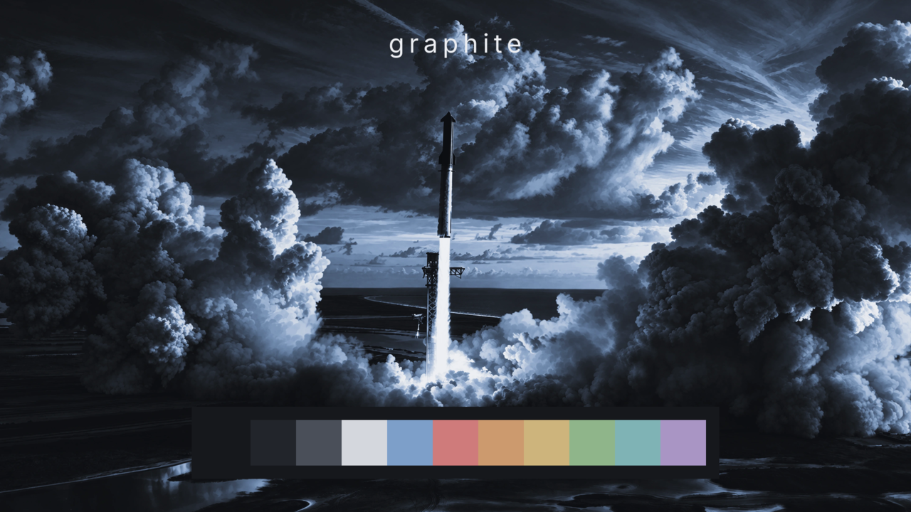

# Graphite

A calm, neutral dark theme for Omarchy: charcoal surfaces, soft grey text and a muted steel-blue accent.



## Install

```bash
omarchy theme install https://github.com/mikailbayram/omarchy-graphite-theme
```

Then pick **Graphite** from the theme menu, or run `omarchy theme set graphite`.

## Notes

- Pairs with [Graphite Light](https://github.com/mikailbayram/omarchy-graphite-light-theme) as a day/night set.
- `icons.theme` names the [WhiteSur](https://github.com/vinceliuice/WhiteSur-icon-theme) icon set (`WhiteSur-dark`). Install it, or change the file to an icon theme you already have, such as `Yaru-blue`.
- Designed alongside Inter for the interface and Geist Mono for terminals, but neither is required.
- Everything else (terminals, Neovim, btop, the shell) is generated by Omarchy from `colors.toml`.

## Credits

The wallpaper is a recoloured version of the "liftoff" background that ships with Omarchy's Tokyo Night theme. [Omarchy](https://github.com/basecamp/omarchy) is MIT licensed.

## License

MIT
